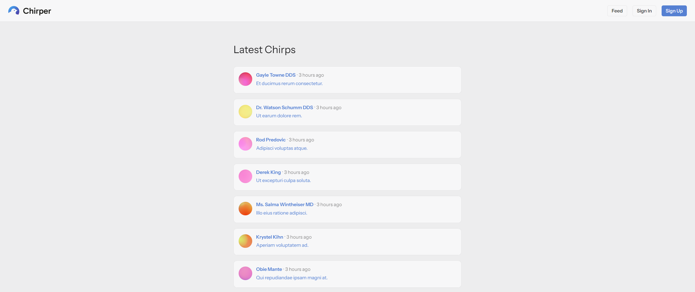
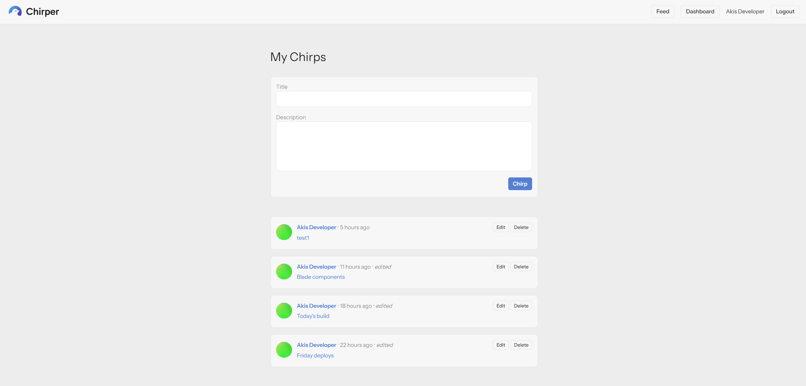
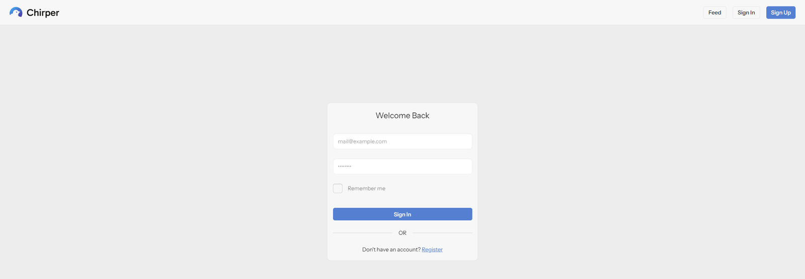

# Chirper

[](https://github.com/koutsavlis/chirper/actions/workflows/tests.yml)

A small micro-blogging app built with Laravel 13. Users can sign up, post short "chirps", edit or delete their own, and browse a public feed and user profiles.

The project started from the official [Laravel Learn bootcamp](https://laravel.com/learn/getting-started-with-laravel). I then extended it with my own features, fixed bugs and added a full test suite and CI.



## What I added beyond the tutorial

- **Private dashboard** for each user, separate from the public feed
- **Titles on chirps**, added through a new migration (not by editing the original one) with validation and custom error messages
- **Public feed** with pagination (`/chirps`)
- **Public chirp pages**: anyone can read a chirp, only the author can edit or delete it (Policy + `@can` in the views)
- **User profile pages** (`/users/{id}`) with the user's chirps and chirp count
- **25 feature tests** with Pest, covering auth, validation, authorization, pagination and regressions
- **GitHub Actions CI** running the tests on every push
- **N+1 protection**: `Model::preventLazyLoading()` outside production and eager loading on every list
- **Privacy fix**: avatar URLs use a hash instead of the user's email, so emails never appear in public HTML
- **Bug fix**: actions redirected to a guest-only page, which caused a double redirect and lost the success message
- **Refactoring**: one shared `ChirpRequest`, invokable controllers for single actions, routes grouped by middleware, named routes everywhere, a custom daisyUI theme

## Screenshots

**Dashboard**: the signed-in user's own chirps, with create, edit and delete



**Sign in**, with the custom daisyUI theme



## Tech stack

- PHP 8.4, Laravel 13
- Blade components, Tailwind CSS 4, daisyUI, Vite
- SQLite
- Pest 4 for testing
- GitHub Actions for CI

## Running locally

Requirements: PHP 8.4, Composer, Node.js.

```bash
git clone https://github.com/koutsavlis/chirper.git
cd chirper
composer setup
php artisan db:seed
composer run dev
```

`composer setup` installs the dependencies, creates `.env`, generates the app key, runs the migrations and builds the frontend. `db:seed` adds sample users and chirps.

Sample login: `alice@example.com` / `password`

## Running the tests

```bash
php artisan test
```

Tests run against an in-memory SQLite database, so your local data is never touched.

## Project structure

| Area | Files |
|---|---|
| Routes | `routes/web.php` (public, guest and authenticated groups) |
| Controllers | `ChirpController`, `DashboardController`, `UserProfileController`, `Auth/*` |
| Authorization | `app/Policies/ChirpPolicy.php` |
| Validation | `app/Http/Requests/ChirpRequest.php` |
| Views | `resources/views` (`components/chirp.blade.php` is reused on every list) |
| Tests | `tests/Feature` |
